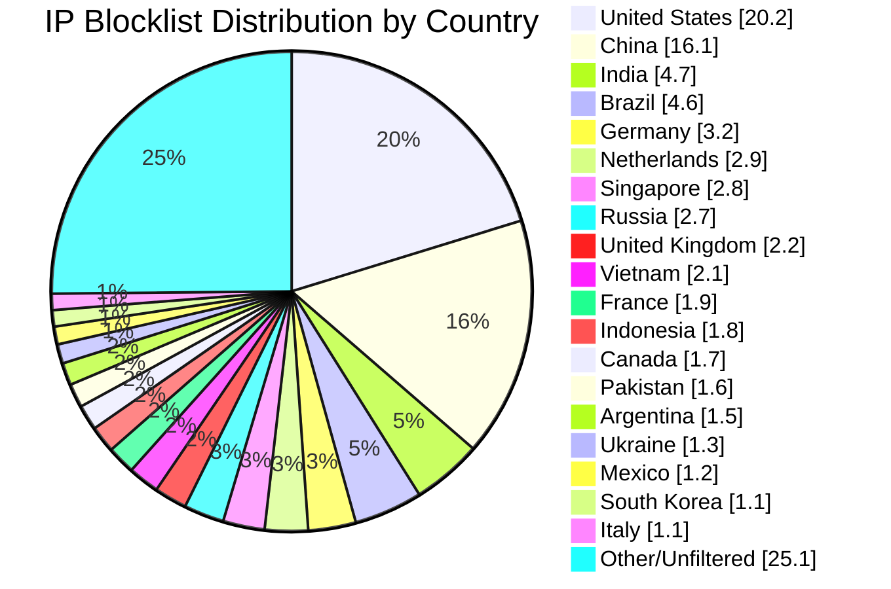

# Multi-Country IP Address Internet Blocklist Aggregator


          


* * *

Automated IP blocklist aggregation with multi-country geographical filtering

* * *

## 🚀 Features

- **Multi-Country Support**: Filter IPs from multiple countries - aggregate or individual lists
- **Automated Aggregation**: Combines multiple IP blocklists into a single deduplicated list
- **Geographical Filtering**: Filters IPs by country with support for multiple countries
- **Individual & Combined Files**: Generates both per-country files and combined multi-country files
- **Docker Support**: Runs in containerized environment for consistency
- **GitHub Actions**: Automated daily updates with manual trigger support
- **Multi-source**: Supports multiple URL sources via environment configuration
- **Enhanced Statistics**: Comprehensive reporting with per-country breakdowns

## 📊 Latest Statistics

**Last Updated:** 2026-11-18 20:47:29 UTC

## 📈 Country Distribution



## Overall Summary

- **Total Input IPs:** 2,154,400
- **Countries Processed:** 50
- **Combined Unique IPs:** 1,897,039
- **Combined Output File:** `aggregated-multi-50countries-combined.txt`
- **Overall Filter Rate:** 88.05%

## Per-Country Results

| Country | Code | Networks Found | Networks Optimized | IPs Matched | Filter Rate | Output File |
|---------|------|----------------|--------------------|-----------|-----------|-----------|
| United States | US | 129,584 | 127,711 | 434,975 | 20.19% | `aggregated-us-only.txt` |
| China | CN | 7,916 | 7,915 | 345,840 | 16.05% | `aggregated-cn-only.txt` |
| India | IN | 13,681 | 13,656 | 100,648 | 4.67% | `aggregated-in-only.txt` |
| Germany | DE | 30,627 | 30,519 | 69,612 | 3.23% | `aggregated-de-only.txt` |
| Russia | RU | 13,387 | 13,161 | 58,437 | 2.71% | `aggregated-ru-only.txt` |
| United Kingdom | GB | 36,568 | 36,414 | 47,795 | 2.22% | `aggregated-gb-only.txt` |
| Thailand | TH | 2,101 | 2,101 | 18,716 | 0.87% | `aggregated-th-only.txt` |
| Vietnam | VN | 2,264 | 2,264 | 45,876 | 2.13% | `aggregated-vn-only.txt` |
| South Korea | KR | 4,001 | 3,992 | 24,562 | 1.14% | `aggregated-kr-only.txt` |
| Brazil | BR | 11,484 | 11,438 | 98,811 | 4.59% | `aggregated-br-only.txt` |
| Taiwan | TW | 2,465 | 2,465 | 22,877 | 1.06% | `aggregated-tw-only.txt` |
| Canada | CA | 17,676 | 17,560 | 37,413 | 1.74% | `aggregated-ca-only.txt` |
| Singapore | SG | 9,821 | 9,809 | 60,203 | 2.79% | `aggregated-sg-only.txt` |
| Italy | IT | 10,034 | 10,009 | 23,861 | 1.11% | `aggregated-it-only.txt` |
| Netherlands | NL | 19,107 | 19,008 | 62,564 | 2.90% | `aggregated-nl-only.txt` |
| Indonesia | ID | 6,829 | 6,808 | 39,827 | 1.85% | `aggregated-id-only.txt` |
| France | FR | 33,666 | 33,636 | 40,736 | 1.89% | `aggregated-fr-only.txt` |
| Venezuela | VE | 1,014 | 1,014 | 10,993 | 0.51% | `aggregated-ve-only.txt` |
| Australia | AU | 11,850 | 11,779 | 21,060 | 0.98% | `aggregated-au-only.txt` |
| Turkey | TR | 3,583 | 3,551 | 22,694 | 1.05% | `aggregated-tr-only.txt` |
| Ukraine | UA | 5,415 | 5,374 | 28,848 | 1.34% | `aggregated-ua-only.txt` |
| Iran | IR | 2,094 | 2,093 | 10,163 | 0.47% | `aggregated-ir-only.txt` |
| Poland | PL | 8,497 | 8,468 | 20,962 | 0.97% | `aggregated-pl-only.txt` |
| Mexico | MX | 4,376 | 4,369 | 26,844 | 1.25% | `aggregated-mx-only.txt` |
| Spain | ES | 11,654 | 11,635 | 16,684 | 0.77% | `aggregated-es-only.txt` |
| Argentina | AR | 3,620 | 3,620 | 31,549 | 1.46% | `aggregated-ar-only.txt` |
| Egypt | EG | 786 | 786 | 5,632 | 0.26% | `aggregated-eg-only.txt` |
| Pakistan | PK | 1,449 | 1,447 | 35,464 | 1.65% | `aggregated-pk-only.txt` |
| Malaysia | MY | 2,680 | 2,680 | 10,267 | 0.48% | `aggregated-my-only.txt` |
| Bulgaria | BG | 2,380 | 2,370 | 4,165 | 0.19% | `aggregated-bg-only.txt` |
| Czechia | CZ | 3,754 | 3,752 | 2,899 | 0.13% | `aggregated-cz-only.txt` |
| Colombia | CO | 2,324 | 2,324 | 12,644 | 0.59% | `aggregated-co-only.txt` |
| United Arab Emirates | AE | 3,970 | 3,970 | 7,009 | 0.33% | `aggregated-ae-only.txt` |
| Romania | RO | 4,120 | 4,109 | 4,651 | 0.22% | `aggregated-ro-only.txt` |
| Kazakhstan | KZ | 1,359 | 1,358 | 4,742 | 0.22% | `aggregated-kz-only.txt` |
| Morocco | MA | 513 | 513 | 6,960 | 0.32% | `aggregated-ma-only.txt` |
| Saudi Arabia | SA | 1,810 | 1,810 | 8,050 | 0.37% | `aggregated-sa-only.txt` |
| South Africa | ZA | 4,000 | 3,987 | 14,510 | 0.67% | `aggregated-za-only.txt` |
| Bangladesh | BD | 2,910 | 2,904 | 19,005 | 0.88% | `aggregated-bd-only.txt` |
| Chile | CL | 2,000 | 1,998 | 10,939 | 0.51% | `aggregated-cl-only.txt` |
| Nigeria | NG | 1,173 | 1,173 | 2,750 | 0.13% | `aggregated-ng-only.txt` |
| Kenya | KE | 922 | 922 | 5,127 | 0.24% | `aggregated-ke-only.txt` |
| Algeria | DZ | 221 | 221 | 2,974 | 0.14% | `aggregated-dz-only.txt` |
| Serbia | RS | 1,019 | 1,019 | 1,979 | 0.09% | `aggregated-rs-only.txt` |
| Peru | PE | 1,128 | 1,127 | 3,682 | 0.17% | `aggregated-pe-only.txt` |
| Sri Lanka | LK | 266 | 266 | 1,168 | 0.05% | `aggregated-lk-only.txt` |
| Iraq | IQ | 702 | 702 | 5,459 | 0.25% | `aggregated-iq-only.txt` |
| Ethiopia | ET | 112 | 112 | 1,870 | 0.09% | `aggregated-et-only.txt` |
| Ghana | GH | 362 | 362 | 819 | 0.04% | `aggregated-gh-only.txt` |
| Belarus | BY | 463 | 463 | 1,724 | 0.08% | `aggregated-by-only.txt` |

## IP Sources

- **Source 1:** https://raw.githubusercontent.com/borestad/firehol-mirror/refs/heads/main/firehol_level1.netset
- **Source 2:** https://raw.githubusercontent.com/borestad/firehol-mirror/refs/heads/main/firehol_level2.netset
- **Source 3:** https://rules.emergingthreats.net/fwrules/emerging-Block-IPs.txt
- **Source 4:** https://feodotracker.abuse.ch/downloads/ipblocklist_recommended.txt
- **Source 5:** https://raw.githubusercontent.com/stamparm/ipsum/master/levels/2.txt
- **Source 6:** https://raw.githubusercontent.com/borestad/iplists/refs/heads/main/spamhaus/spamhaus-drop.ipv4
- **Source 7:** https://raw.githubusercontent.com/borestad/iplists/refs/heads/main/spamhaus/spamhaus-asndrop.ipv4
- **Source 8:** https://raw.githubusercontent.com/romainmarcoux/malicious-ip/refs/heads/main/full-300k-aa.txt
- **Source 9:** https://raw.githubusercontent.com/romainmarcoux/malicious-ip/refs/heads/main/full-300k-ab.txt
- **Source 10:** https://raw.githubusercontent.com/romainmarcoux/malicious-ip/refs/heads/main/full-300k-ac.txt
- **Source 11:** https://raw.githubusercontent.com/romainmarcoux/malicious-ip/refs/heads/main/full-300k-ad.txt
- **Source 12:** http://cinsscore.com/list/ci-badguys.txt
- **Source 13:** https://cdn.jsdelivr.net/gh/LittleJake/ip-blacklist/all_blacklist.txt
- **Source 14:** https://raw.githubusercontent.com/MagicTeaMC/bad-ips/refs/heads/main/bad-ips.txt
- **Source 15:** https://raw.githubusercontent.com/MagicTeaMC/MCSTORM-IP/main/mcstorm-ip.txt
- **Source 16:** https://opendbl.net/lists/blocklistde-all.list
- **Source 17:** https://raw.githubusercontent.com/bitwire-it/ipblocklist/refs/heads/main/ip-list.txt
- **Source 18:** https://raw.githubusercontent.com/sefinek/Malicious-IP-Addresses/refs/heads/main/lists/main.txt
- **Source 19:** https://raw.githubusercontent.com/borestad/firehol-mirror/refs/heads/main/firehol_level3.netset
- **Source 20:** https://raw.githubusercontent.com/borestad/firehol-mirror/refs/heads/main/firehol_level4.netset
- **Source 21:** https://raw.githubusercontent.com/borestad/firehol-mirror/refs/heads/main/firehol_webserver.netset

## Configuration Details


### 📁 Generated Files

- **`aggregated.txt`** - 2,154,400 total aggregated IPs from all sources
- **`aggregated-ae-only.txt`** - 7,009 IPs from AE
- **`aggregated-ar-only.txt`** - 31,549 IPs from AR
- **`aggregated-au-only.txt`** - 21,060 IPs from AU
- **`aggregated-bd-only.txt`** - 19,005 IPs from BD
- **`aggregated-bg-only.txt`** - 4,165 IPs from BG
- **`aggregated-br-only.txt`** - 98,811 IPs from BR
- **`aggregated-by-only.txt`** - 1,724 IPs from BY
- **`aggregated-ca-only.txt`** - 37,413 IPs from CA
- **`aggregated-cl-only.txt`** - 10,939 IPs from CL
- **`aggregated-cn-only.txt`** - 345,840 IPs from CN
- **`aggregated-co-only.txt`** - 12,644 IPs from CO
- **`aggregated-cz-only.txt`** - 2,899 IPs from CZ
- **`aggregated-de-only.txt`** - 69,612 IPs from DE
- **`aggregated-dz-only.txt`** - 2,974 IPs from DZ
- **`aggregated-eg-only.txt`** - 5,632 IPs from EG
- **`aggregated-es-only.txt`** - 16,684 IPs from ES
- **`aggregated-et-only.txt`** - 1,870 IPs from ET
- **`aggregated-fr-only.txt`** - 40,736 IPs from FR
- **`aggregated-gb-only.txt`** - 47,795 IPs from GB
- **`aggregated-gh-only.txt`** - 819 IPs from GH
- **`aggregated-id-only.txt`** - 39,827 IPs from ID
- **`aggregated-in-only.txt`** - 100,648 IPs from IN
- **`aggregated-iq-only.txt`** - 5,459 IPs from IQ
- **`aggregated-ir-only.txt`** - 10,163 IPs from IR
- **`aggregated-it-only.txt`** - 23,861 IPs from IT
- **`aggregated-ke-only.txt`** - 5,127 IPs from KE
- **`aggregated-kr-only.txt`** - 24,562 IPs from KR
- **`aggregated-kz-only.txt`** - 4,742 IPs from KZ
- **`aggregated-lk-only.txt`** - 1,168 IPs from LK
- **`aggregated-ma-only.txt`** - 6,960 IPs from MA
- **`aggregated-mx-only.txt`** - 26,844 IPs from MX
- **`aggregated-my-only.txt`** - 10,267 IPs from MY
- **`aggregated-ng-only.txt`** - 2,750 IPs from NG
- **`aggregated-nl-only.txt`** - 62,564 IPs from NL
- **`aggregated-pe-only.txt`** - 3,682 IPs from PE
- **`aggregated-pk-only.txt`** - 35,464 IPs from PK
- **`aggregated-pl-only.txt`** - 20,962 IPs from PL
- **`aggregated-ro-only.txt`** - 4,651 IPs from RO
- **`aggregated-rs-only.txt`** - 1,979 IPs from RS
- **`aggregated-ru-only.txt`** - 58,437 IPs from RU
- **`aggregated-sa-only.txt`** - 8,050 IPs from SA
- **`aggregated-sg-only.txt`** - 60,203 IPs from SG
- **`aggregated-th-only.txt`** - 18,716 IPs from TH
- **`aggregated-tr-only.txt`** - 22,694 IPs from TR
- **`aggregated-tw-only.txt`** - 22,877 IPs from TW
- **`aggregated-ua-only.txt`** - 28,848 IPs from UA
- **`aggregated-us-only.txt`** - 434,975 IPs from US
- **`aggregated-ve-only.txt`** - 10,993 IPs from VE
- **`aggregated-vn-only.txt`** - 45,876 IPs from VN
- **`aggregated-za-only.txt`** - 14,510 IPs from ZA
- **`aggregated-multi-50countries-combined.txt`** - 1,897,039 unique IPs (deduplicated across all countries)

---

## 🛴 Install

Set up your own copy of this repository to aggregate and filter your IP blocklists for multiple countries.

* * *

### 👆 Click the green "Use this template" button in the upper right corner

         
1. **Sign in** to GitHub and navigate to [this repository](https://github.com/dewdmadbro/ip-blocklist-dewd).
2. Click the **"Use this template"** button (in the upper right corner).
3. Select **Create a new repository**. Enter a name (e.g., `my-eu-badip-blocklist`), and confirm.
4. Your new repository is now independent — it will not share commit history with the original.
5. You can immediately begin editing or configuring it for your own multi-country IP aggregation project.

> The **"Use this template"** button on GitHub allows you to quickly create a new, independent repository pre-populated with the project's files and structure. Your new repository won't inherit commit history from the template. This is perfect for your personal blocklist repo.

*Usage is below for steps on running this repository with Github Actions in your new IP aggregation project.*


## 🛠 Usage

### GitHub Actions (Recommended)

#### First Step - Enable Write Permissions

1. **Enable Actions**: Go to Settings > Actions > General > Workflow permissions
2. **Set Permissions**: Select "Read and write permissions", click "Save".


#### Second Step - Configure The Repo

3. **Configure Environment**: Edit `.env` file with your desired sources and countries
4. **Your Favorite Blocklists**: Load as many blocklists as you like, just make sure the line starts with `LIST1_`, `LIST2_`, `LIST3_`, etc.
5. **Multiple Countries**: Countries can be modified the same way, `COUNTRY_ISO_CODE_1`, `COUNTRY_NAME_1`, `COUNTRY_ISO_CODE_2`, `COUNTRY_NAME_2`, etc.
6. **Find Country Codes**: You can find your country codes in the [geoip2-ipv4 spreadsheet](https://datahub.io/core/geoip2-ipv4)
7. **Automatic Runs**: The workflow runs twice daily. At both **02:17 AM/PM UTC** or it will run anytime if you [modified the cron file](https://github.com/dewdmadbro/ip-blocklist-dewd/edit/main/.github/workflows/ip-aggregation.yml)


#### Third Step - Running This Action

8. **Run This Now**: You can run this Github Action by using the "Action" tab up top
9. **Generate Multi-Country Blocklists**: Under "All workflows" you can find this action
10. **Run workflow**: On this page, off to the right is a button with a dropdown to "Run workflow"
11. **Off to the races**: Each run will consume some of your free monthly Github Actions 2000 min (33.3 hours)

> Please adjust cron, it is how often your aggregator runs in [.github/workflows/ip-aggregation.yml](https://github.com/dewdmadbro/ip-blocklist-dewd/edit/main/.github/workflows/ip-aggregation.yml), also modify your blacklists and countries in the [.env](https://github.com/dewdmadbro/ip-blocklist-dewd/edit/main/.env) file.

## ⚙ Configuration

### 🌍 Multi-Country Setup

The `.env` file supports multiple countries:

```bash
# European Union Example
COUNTRY_ISO_CODE_1=DE
COUNTRY_NAME_1=Germany

COUNTRY_ISO_CODE_2=FR
COUNTRY_NAME_2=France

COUNTRY_ISO_CODE_3=NL
COUNTRY_NAME_3=Netherlands

COUNTRY_ISO_CODE_4=IT
COUNTRY_NAME_4=Italy

COUNTRY_ISO_CODE_5=ES
COUNTRY_NAME_5=Spain
```

This will generate:
- `aggregated-de-only.txt` (Germany IPs)
- `aggregated-fr-only.txt` (France IPs) 
- `aggregated-nl-only.txt` (Netherlands IPs)
- `aggregated-it-only.txt` (Italy IPs)
- `aggregated-es-only.txt` (Spain IPs)
- `aggregated-multi-5countries-combined.txt` (All countries combined, deduplicated)

### Sample .env file

```bash
# Add your IP list sources
LIST_1=https://example.com/blocklist1.txt
LIST_2=https://example.com/blocklist2.txt

# Set multiple countries (NEW FEATURE!)
COUNTRY_ISO_CODE_1=DE
COUNTRY_NAME_1=Germany

COUNTRY_ISO_CODE_2=FR  
COUNTRY_NAME_2=France

# Configure paths (usually don't need to change)
GEOIP_CSV_PATH=/data/geoip/geoip2-ipv4.csv
ALL_IPS_FROM_LISTS=/data/output/aggregated.txt
```

## 🏠 Local Deployment (Alternative)

If you'd rather download this repo and run this project offline, the instructions are below:

### 1. Clone the repository

The first step is to download the files from the internet, and get them locally on your machine.

```bash
git clone https://github.com/dewdmadbro/ip-blocklist-dewd.git
```

### 2. Configure your sources and countries in .env

The next step is to configure the project to your liking. Edit your `.env` file. You can enter as many IP based block lists as you need and configure multiple countries.

```bash
nano .env
```

### 3. Run with Docker Compose

You can now run the project and see what happens.

```bash
docker compose up --build
```

### 4. Check results

Let's see what happened!

```bash
ls -la data/output/
```

## 📁 Output Files

### Per-Country Files
- `data/output/aggregated-{country-code}-only.txt` - Country-specific IPs (e.g., `aggregated-de-only.txt` for Germany)

### Combined Multi-Country Files  
- `data/output/aggregated-multi-{number-of-countries-total}countries-combined.txt` - Combined IPs from all countries (deduplicated)
- Example: `aggregated-multi-3countries-combined.txt` for Germany + France + Netherlands

### Core Files
- `data/output/aggregated.txt` - All deduplicated IPs from all sources (before country filtering)
- `data/output/stats.md` - Comprehensive processing statistics with per-country breakdowns

## 🔄 Workflow Triggers

The GitHub Action runs automatically when:

- **Daily Schedule**: Every day, twice. Once at at 02:17 AM UTC and then again at 02:17 PM UTC
- **File Changes**: When `.env`, `Dockerfile`, or key scripts are modified
- **Manual Trigger**: Via GitHub Actions interface


## 🧹 Starting With Clean Output

If you're going to customize the list: 

- You should remove the [./data/output](https://github.com/dewdmadbro/ip-blocklist-dewd/edit/main/data/output) folder, as it will only contain data pertinent to the last run.

- Always remove the [./data/output](https://github.com/dewdmadbro/ip-blocklist-dewd/edit/main/data/output) folder when you customize the countries. 

> This will ensure you dont include older, unused countries in your new aggreagtion lists.


## ⚡ Performance

- **Multi-Country Processing**: Parallel processing of multiple countries
- **Processing Speed**: ~10,000 IPs per second for filtering per country
- **Parallel Processing**: Multi-core optimization for large datasets  
- **Memory Efficient**: Streaming processing for large files
- **Optimized Lookup**: Integer-based IP range matching with SubnetTree
- **Network Optimization**: Automatic collapsing of overlapping CIDR blocks

## 🌼 Features and Optimizations

- **🌍 Multi-country IP blocklist aggregation** for comprehensive regional security  
- **📊 Per-country statistical analysis** with detailed filtering metrics
- **🔄 Automated multi-country updates** via GitHub Actions
- **🚀 Parallel country processing** for improved performance
- **📁 Individual and combined output files** for flexible deployment
- **🛡️ Regional threat mitigation** with configurable multi-country rules
- **💾 Memory-efficient processing** even with multiple large country datasets
- **🔗 Network optimization** with automatic CIDR block collapsing

## 👍 Acknowledgements

This project would not have been possible without the amazing work of the following other projects:

* * *

### 🎩 Datopian

Thank you to [Datopian](https://github.com/datasets/geoip2-ipv4) for maintaining the [GeoIP2 IPv4 dataset](https://datahub.io/core/geoip2-ipv4). This dataset provides otherwise impossible information for IP geolocation, allowing this project to filter IPs based on multiple countries simultaneously.

- [GeoIP2 IPv4 Dataset](https://datahub.io/core/geoip2-ipv4) by Datopian is essential for filtering and identifying IP addresses across various countries, enabling the dynamic multi-country functionality of this project.


* * *

### 🦘 Andrew Twin

Special thanks to [Andrew Twin](https://github.com/andrewtwin) for creating and sharing the [IP Aggregator](https://github.com/andrewtwin/ip-aggregator) project. Andrew's work on efficiently aggregating IP blocklists was a fundamental inspiration and foundation for this enhanced multi-country version.

- The [IP Aggregator](https://github.com/andrewtwin/ip-aggregator) allows easy downloading, parsing, and filtering of multiple IP blocklists, which this project leverages and extends for multi-country IP management tasks.


* * *

### 📗 Blocklist maintainers

I would like to additionally acknowledge the maintainers and contributors of various [IP blocklists](https://github.com/topics/ip-blocklist) and [IP blacklists](https://github.com/topics/ip-blacklist). Thank you for maintaining up-to-date, community-driven threat intelligence that forms the foundation of generating these multi-country filtered files. While the specific lists in this repo may vary, the collective dedication to improving online security and privacy of all contributors is deeply appreciated.


* * *

