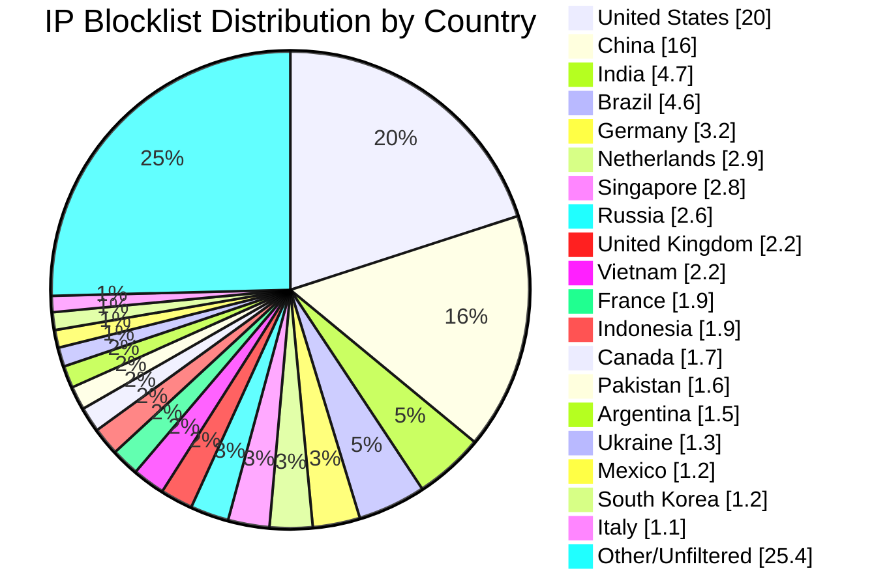

# Multi-Country IP Aggregation Statistics

**Last Updated:** 2026-11-15 19:02:59 UTC

## 📈 Country Distribution

## Overall Summary

- **Total Input IPs:** 2,104,506
- **Countries Processed:** 50
- **Combined Unique IPs:** 1,850,735
- **Combined Output File:** `aggregated-multi-50countries-combined.txt`
- **Overall Filter Rate:** 87.94%

## Per-Country Results

| Country | Code | Networks Found | Networks Optimized | IPs Matched | Filter Rate | Output File |
|---------|------|----------------|--------------------|-----------|-----------|-----------|
| United States | US | 129,584 | 127,711 | 420,910 | 20.00% | `aggregated-us-only.txt` |
| China | CN | 7,916 | 7,915 | 336,388 | 15.98% | `aggregated-cn-only.txt` |
| India | IN | 13,681 | 13,656 | 98,505 | 4.68% | `aggregated-in-only.txt` |
| Germany | DE | 30,627 | 30,519 | 66,723 | 3.17% | `aggregated-de-only.txt` |
| Russia | RU | 13,387 | 13,161 | 55,446 | 2.63% | `aggregated-ru-only.txt` |
| United Kingdom | GB | 36,568 | 36,414 | 46,765 | 2.22% | `aggregated-gb-only.txt` |
| Thailand | TH | 2,101 | 2,101 | 18,585 | 0.88% | `aggregated-th-only.txt` |
| Vietnam | VN | 2,264 | 2,264 | 45,728 | 2.17% | `aggregated-vn-only.txt` |
| South Korea | KR | 4,001 | 3,992 | 24,364 | 1.16% | `aggregated-kr-only.txt` |
| Brazil | BR | 11,484 | 11,438 | 97,731 | 4.64% | `aggregated-br-only.txt` |
| Taiwan | TW | 2,465 | 2,465 | 22,603 | 1.07% | `aggregated-tw-only.txt` |
| Canada | CA | 17,676 | 17,560 | 36,464 | 1.73% | `aggregated-ca-only.txt` |
| Singapore | SG | 9,821 | 9,809 | 58,876 | 2.80% | `aggregated-sg-only.txt` |
| Italy | IT | 10,034 | 10,009 | 23,512 | 1.12% | `aggregated-it-only.txt` |
| Netherlands | NL | 19,107 | 19,008 | 61,839 | 2.94% | `aggregated-nl-only.txt` |
| Indonesia | ID | 6,829 | 6,808 | 39,084 | 1.86% | `aggregated-id-only.txt` |
| France | FR | 33,666 | 33,636 | 39,727 | 1.89% | `aggregated-fr-only.txt` |
| Venezuela | VE | 1,014 | 1,014 | 10,953 | 0.52% | `aggregated-ve-only.txt` |
| Australia | AU | 11,850 | 11,779 | 20,929 | 0.99% | `aggregated-au-only.txt` |
| Turkey | TR | 3,583 | 3,551 | 22,490 | 1.07% | `aggregated-tr-only.txt` |
| Ukraine | UA | 5,415 | 5,374 | 28,096 | 1.34% | `aggregated-ua-only.txt` |
| Iran | IR | 2,094 | 2,093 | 9,793 | 0.47% | `aggregated-ir-only.txt` |
| Poland | PL | 8,497 | 8,468 | 20,757 | 0.99% | `aggregated-pl-only.txt` |
| Mexico | MX | 4,376 | 4,369 | 26,258 | 1.25% | `aggregated-mx-only.txt` |
| Spain | ES | 11,654 | 11,635 | 16,444 | 0.78% | `aggregated-es-only.txt` |
| Argentina | AR | 3,620 | 3,620 | 31,113 | 1.48% | `aggregated-ar-only.txt` |
| Egypt | EG | 786 | 786 | 5,598 | 0.27% | `aggregated-eg-only.txt` |
| Pakistan | PK | 1,449 | 1,447 | 33,369 | 1.59% | `aggregated-pk-only.txt` |
| Malaysia | MY | 2,680 | 2,680 | 10,131 | 0.48% | `aggregated-my-only.txt` |
| Bulgaria | BG | 2,380 | 2,370 | 4,117 | 0.20% | `aggregated-bg-only.txt` |
| Czechia | CZ | 3,754 | 3,752 | 2,862 | 0.14% | `aggregated-cz-only.txt` |
| Colombia | CO | 2,324 | 2,324 | 12,564 | 0.60% | `aggregated-co-only.txt` |
| United Arab Emirates | AE | 3,970 | 3,970 | 6,972 | 0.33% | `aggregated-ae-only.txt` |
| Romania | RO | 4,120 | 4,109 | 4,452 | 0.21% | `aggregated-ro-only.txt` |
| Kazakhstan | KZ | 1,359 | 1,358 | 4,743 | 0.23% | `aggregated-kz-only.txt` |
| Morocco | MA | 513 | 513 | 6,883 | 0.33% | `aggregated-ma-only.txt` |
| Saudi Arabia | SA | 1,810 | 1,810 | 7,988 | 0.38% | `aggregated-sa-only.txt` |
| South Africa | ZA | 4,000 | 3,987 | 13,751 | 0.65% | `aggregated-za-only.txt` |
| Bangladesh | BD | 2,910 | 2,904 | 19,049 | 0.91% | `aggregated-bd-only.txt` |
| Chile | CL | 2,000 | 1,998 | 10,825 | 0.51% | `aggregated-cl-only.txt` |
| Nigeria | NG | 1,173 | 1,173 | 2,729 | 0.13% | `aggregated-ng-only.txt` |
| Kenya | KE | 922 | 922 | 5,080 | 0.24% | `aggregated-ke-only.txt` |
| Algeria | DZ | 221 | 221 | 2,952 | 0.14% | `aggregated-dz-only.txt` |
| Serbia | RS | 1,019 | 1,019 | 1,955 | 0.09% | `aggregated-rs-only.txt` |
| Peru | PE | 1,128 | 1,127 | 3,640 | 0.17% | `aggregated-pe-only.txt` |
| Sri Lanka | LK | 266 | 266 | 1,157 | 0.05% | `aggregated-lk-only.txt` |
| Iraq | IQ | 702 | 702 | 5,463 | 0.26% | `aggregated-iq-only.txt` |
| Ethiopia | ET | 112 | 112 | 1,847 | 0.09% | `aggregated-et-only.txt` |
| Ghana | GH | 362 | 362 | 818 | 0.04% | `aggregated-gh-only.txt` |
| Belarus | BY | 463 | 463 | 1,707 | 0.08% | `aggregated-by-only.txt` |

## IP Sources

- **Source 1:** https://raw.githubusercontent.com/borestad/firehol-mirror/refs/heads/main/firehol_level1.netset
- **Source 2:** https://raw.githubusercontent.com/borestad/firehol-mirror/refs/heads/main/firehol_level2.netset
- **Source 3:** https://rules.emergingthreats.net/fwrules/emerging-Block-IPs.txt
- **Source 4:** https://feodotracker.abuse.ch/downloads/ipblocklist_recommended.txt
- **Source 5:** https://raw.githubusercontent.com/stamparm/ipsum/master/levels/2.txt
- **Source 6:** https://raw.githubusercontent.com/borestad/iplists/refs/heads/main/spamhaus/spamhaus-drop.ipv4
- **Source 7:** https://raw.githubusercontent.com/borestad/iplists/refs/heads/main/spamhaus/spamhaus-asndrop.ipv4
- **Source 8:** https://raw.githubusercontent.com/romainmarcoux/malicious-ip/refs/heads/main/full-300k-aa.txt
- **Source 9:** https://raw.githubusercontent.com/romainmarcoux/malicious-ip/refs/heads/main/full-300k-ab.txt
- **Source 10:** https://raw.githubusercontent.com/romainmarcoux/malicious-ip/refs/heads/main/full-300k-ac.txt
- **Source 11:** https://raw.githubusercontent.com/romainmarcoux/malicious-ip/refs/heads/main/full-300k-ad.txt
- **Source 12:** http://cinsscore.com/list/ci-badguys.txt
- **Source 13:** https://cdn.jsdelivr.net/gh/LittleJake/ip-blacklist/all_blacklist.txt
- **Source 14:** https://raw.githubusercontent.com/MagicTeaMC/bad-ips/refs/heads/main/bad-ips.txt
- **Source 15:** https://raw.githubusercontent.com/MagicTeaMC/MCSTORM-IP/main/mcstorm-ip.txt
- **Source 16:** https://opendbl.net/lists/blocklistde-all.list
- **Source 17:** https://raw.githubusercontent.com/bitwire-it/ipblocklist/refs/heads/main/ip-list.txt
- **Source 18:** https://raw.githubusercontent.com/sefinek/Malicious-IP-Addresses/refs/heads/main/lists/main.txt
- **Source 19:** https://raw.githubusercontent.com/borestad/firehol-mirror/refs/heads/main/firehol_level3.netset
- **Source 20:** https://raw.githubusercontent.com/borestad/firehol-mirror/refs/heads/main/firehol_level4.netset
- **Source 21:** https://raw.githubusercontent.com/borestad/firehol-mirror/refs/heads/main/firehol_webserver.netset

## Configuration Details

