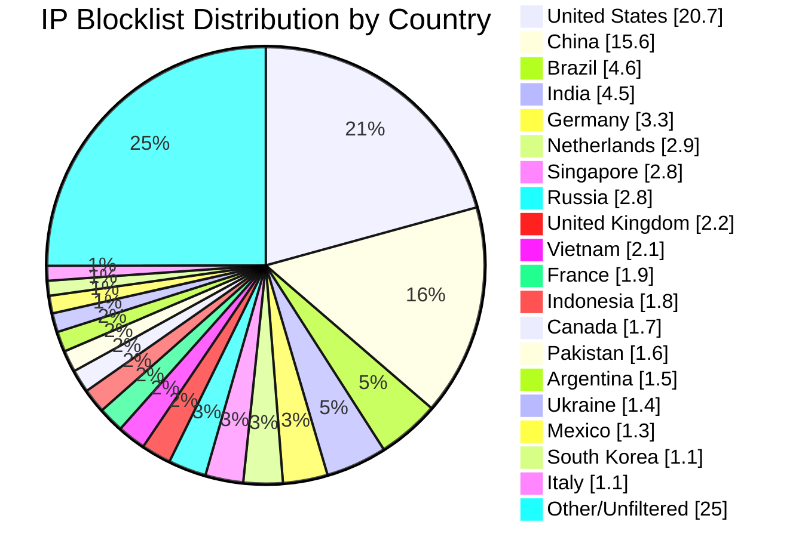

# Multi-Country IP Aggregation Statistics

**Last Updated:** 2026-11-26 08:44:12 UTC

## 📈 Country Distribution

## Overall Summary

- **Total Input IPs:** 2,194,133
- **Countries Processed:** 50
- **Combined Unique IPs:** 1,932,723
- **Combined Output File:** `aggregated-multi-50countries-combined.txt`
- **Overall Filter Rate:** 88.09%

## Per-Country Results

| Country | Code | Networks Found | Networks Optimized | IPs Matched | Filter Rate | Output File |
|---------|------|----------------|--------------------|-----------|-----------|-----------|
| United States | US | 131,096 | 129,226 | 454,657 | 20.72% | `aggregated-us-only.txt` |
| China | CN | 7,927 | 7,926 | 342,611 | 15.61% | `aggregated-cn-only.txt` |
| India | IN | 13,799 | 13,774 | 98,334 | 4.48% | `aggregated-in-only.txt` |
| Germany | DE | 30,809 | 30,705 | 72,289 | 3.29% | `aggregated-de-only.txt` |
| Russia | RU | 13,434 | 13,203 | 61,085 | 2.78% | `aggregated-ru-only.txt` |
| United Kingdom | GB | 36,853 | 36,697 | 49,213 | 2.24% | `aggregated-gb-only.txt` |
| Thailand | TH | 2,112 | 2,112 | 18,810 | 0.86% | `aggregated-th-only.txt` |
| Vietnam | VN | 2,294 | 2,294 | 46,082 | 2.10% | `aggregated-vn-only.txt` |
| South Korea | KR | 4,056 | 4,047 | 24,612 | 1.12% | `aggregated-kr-only.txt` |
| Brazil | BR | 11,637 | 11,590 | 100,846 | 4.60% | `aggregated-br-only.txt` |
| Taiwan | TW | 2,538 | 2,538 | 22,632 | 1.03% | `aggregated-tw-only.txt` |
| Canada | CA | 17,849 | 17,727 | 38,228 | 1.74% | `aggregated-ca-only.txt` |
| Singapore | SG | 9,895 | 9,883 | 61,502 | 2.80% | `aggregated-sg-only.txt` |
| Italy | IT | 10,117 | 10,080 | 24,283 | 1.11% | `aggregated-it-only.txt` |
| Netherlands | NL | 19,221 | 19,122 | 64,363 | 2.93% | `aggregated-nl-only.txt` |
| Indonesia | ID | 6,879 | 6,858 | 40,408 | 1.84% | `aggregated-id-only.txt` |
| France | FR | 33,764 | 33,733 | 41,759 | 1.90% | `aggregated-fr-only.txt` |
| Venezuela | VE | 1,023 | 1,023 | 11,110 | 0.51% | `aggregated-ve-only.txt` |
| Australia | AU | 11,856 | 11,786 | 21,278 | 0.97% | `aggregated-au-only.txt` |
| Turkey | TR | 3,618 | 3,591 | 23,326 | 1.06% | `aggregated-tr-only.txt` |
| Ukraine | UA | 5,421 | 5,379 | 29,968 | 1.37% | `aggregated-ua-only.txt` |
| Iran | IR | 2,080 | 2,079 | 10,758 | 0.49% | `aggregated-ir-only.txt` |
| Poland | PL | 8,541 | 8,513 | 20,471 | 0.93% | `aggregated-pl-only.txt` |
| Mexico | MX | 4,451 | 4,444 | 27,789 | 1.27% | `aggregated-mx-only.txt` |
| Spain | ES | 11,794 | 11,775 | 17,448 | 0.80% | `aggregated-es-only.txt` |
| Argentina | AR | 3,666 | 3,666 | 32,238 | 1.47% | `aggregated-ar-only.txt` |
| Egypt | EG | 800 | 800 | 5,639 | 0.26% | `aggregated-eg-only.txt` |
| Pakistan | PK | 1,462 | 1,460 | 36,101 | 1.65% | `aggregated-pk-only.txt` |
| Malaysia | MY | 2,720 | 2,720 | 10,577 | 0.48% | `aggregated-my-only.txt` |
| Bulgaria | BG | 2,392 | 2,378 | 4,266 | 0.19% | `aggregated-bg-only.txt` |
| Czechia | CZ | 3,807 | 3,805 | 2,994 | 0.14% | `aggregated-cz-only.txt` |
| Colombia | CO | 2,372 | 2,372 | 12,944 | 0.59% | `aggregated-co-only.txt` |
| United Arab Emirates | AE | 4,004 | 4,004 | 7,083 | 0.32% | `aggregated-ae-only.txt` |
| Romania | RO | 4,161 | 4,150 | 4,964 | 0.23% | `aggregated-ro-only.txt` |
| Kazakhstan | KZ | 1,378 | 1,377 | 4,841 | 0.22% | `aggregated-kz-only.txt` |
| Morocco | MA | 531 | 531 | 6,874 | 0.31% | `aggregated-ma-only.txt` |
| Saudi Arabia | SA | 1,825 | 1,825 | 8,215 | 0.37% | `aggregated-sa-only.txt` |
| South Africa | ZA | 4,009 | 3,996 | 13,317 | 0.61% | `aggregated-za-only.txt` |
| Bangladesh | BD | 2,961 | 2,956 | 19,643 | 0.90% | `aggregated-bd-only.txt` |
| Chile | CL | 2,020 | 2,018 | 11,244 | 0.51% | `aggregated-cl-only.txt` |
| Nigeria | NG | 1,195 | 1,195 | 2,715 | 0.12% | `aggregated-ng-only.txt` |
| Kenya | KE | 934 | 934 | 5,287 | 0.24% | `aggregated-ke-only.txt` |
| Algeria | DZ | 233 | 233 | 2,926 | 0.13% | `aggregated-dz-only.txt` |
| Serbia | RS | 1,033 | 1,033 | 1,994 | 0.09% | `aggregated-rs-only.txt` |
| Peru | PE | 1,168 | 1,167 | 3,773 | 0.17% | `aggregated-pe-only.txt` |
| Sri Lanka | LK | 275 | 275 | 1,159 | 0.05% | `aggregated-lk-only.txt` |
| Iraq | IQ | 721 | 721 | 5,596 | 0.26% | `aggregated-iq-only.txt` |
| Ethiopia | ET | 122 | 122 | 1,872 | 0.09% | `aggregated-et-only.txt` |
| Ghana | GH | 373 | 373 | 834 | 0.04% | `aggregated-gh-only.txt` |
| Belarus | BY | 467 | 467 | 1,765 | 0.08% | `aggregated-by-only.txt` |

## IP Sources

- **Source 1:** https://raw.githubusercontent.com/borestad/firehol-mirror/refs/heads/main/firehol_level1.netset
- **Source 2:** https://raw.githubusercontent.com/borestad/firehol-mirror/refs/heads/main/firehol_level2.netset
- **Source 3:** https://rules.emergingthreats.net/fwrules/emerging-Block-IPs.txt
- **Source 4:** https://feodotracker.abuse.ch/downloads/ipblocklist_recommended.txt
- **Source 5:** https://raw.githubusercontent.com/stamparm/ipsum/master/levels/2.txt
- **Source 6:** https://raw.githubusercontent.com/borestad/iplists/refs/heads/main/spamhaus/spamhaus-drop.ipv4
- **Source 7:** https://raw.githubusercontent.com/borestad/iplists/refs/heads/main/spamhaus/spamhaus-asndrop.ipv4
- **Source 8:** https://raw.githubusercontent.com/romainmarcoux/malicious-ip/refs/heads/main/full-300k-aa.txt
- **Source 9:** https://raw.githubusercontent.com/romainmarcoux/malicious-ip/refs/heads/main/full-300k-ab.txt
- **Source 10:** https://raw.githubusercontent.com/romainmarcoux/malicious-ip/refs/heads/main/full-300k-ac.txt
- **Source 11:** https://raw.githubusercontent.com/romainmarcoux/malicious-ip/refs/heads/main/full-300k-ad.txt
- **Source 12:** http://cinsscore.com/list/ci-badguys.txt
- **Source 13:** https://cdn.jsdelivr.net/gh/LittleJake/ip-blacklist/all_blacklist.txt
- **Source 14:** https://raw.githubusercontent.com/MagicTeaMC/bad-ips/refs/heads/main/bad-ips.txt
- **Source 15:** https://raw.githubusercontent.com/MagicTeaMC/MCSTORM-IP/main/mcstorm-ip.txt
- **Source 16:** https://opendbl.net/lists/blocklistde-all.list
- **Source 17:** https://raw.githubusercontent.com/bitwire-it/ipblocklist/refs/heads/main/ip-list.txt
- **Source 18:** https://raw.githubusercontent.com/sefinek/Malicious-IP-Addresses/refs/heads/main/lists/main.txt
- **Source 19:** https://raw.githubusercontent.com/borestad/firehol-mirror/refs/heads/main/firehol_level3.netset
- **Source 20:** https://raw.githubusercontent.com/borestad/firehol-mirror/refs/heads/main/firehol_level4.netset
- **Source 21:** https://raw.githubusercontent.com/borestad/firehol-mirror/refs/heads/main/firehol_webserver.netset

## Configuration Details

