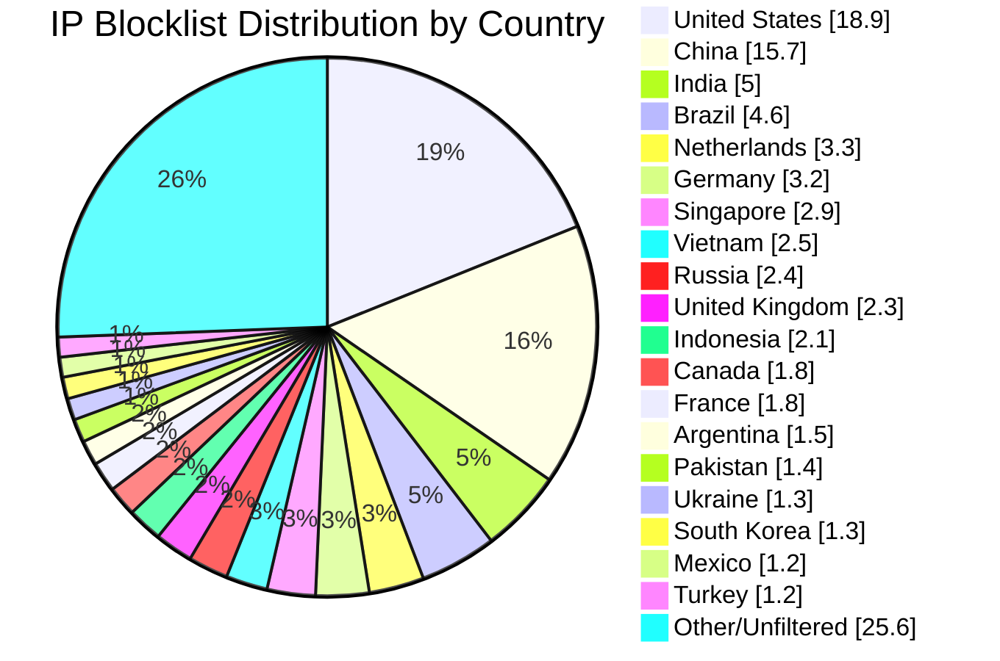

# Multi-Country IP Aggregation Statistics

**Last Updated:** 2026-10-15 17:15:46 UTC

## 📈 Country Distribution

## Overall Summary

- **Total Input IPs:** 1,725,321
- **Countries Processed:** 50
- **Combined Unique IPs:** 1,512,341
- **Combined Output File:** `aggregated-multi-50countries-combined.txt`
- **Overall Filter Rate:** 87.66%

## Per-Country Results

| Country | Code | Networks Found | Networks Optimized | IPs Matched | Filter Rate | Output File |
|---------|------|----------------|--------------------|-----------|-----------|-----------|
| United States | US | 128,498 | 126,625 | 326,794 | 18.94% | `aggregated-us-only.txt` |
| China | CN | 8,206 | 8,205 | 270,742 | 15.69% | `aggregated-cn-only.txt` |
| India | IN | 13,510 | 13,485 | 86,161 | 4.99% | `aggregated-in-only.txt` |
| Germany | DE | 30,255 | 30,145 | 54,591 | 3.16% | `aggregated-de-only.txt` |
| Russia | RU | 13,265 | 13,023 | 40,601 | 2.35% | `aggregated-ru-only.txt` |
| United Kingdom | GB | 36,309 | 36,137 | 39,815 | 2.31% | `aggregated-gb-only.txt` |
| Thailand | TH | 2,095 | 2,095 | 17,207 | 1.00% | `aggregated-th-only.txt` |
| Vietnam | VN | 2,260 | 2,260 | 42,411 | 2.46% | `aggregated-vn-only.txt` |
| South Korea | KR | 3,979 | 3,956 | 22,230 | 1.29% | `aggregated-kr-only.txt` |
| Brazil | BR | 11,520 | 11,481 | 80,154 | 4.65% | `aggregated-br-only.txt` |
| Taiwan | TW | 2,458 | 2,458 | 20,015 | 1.16% | `aggregated-tw-only.txt` |
| Canada | CA | 17,644 | 17,526 | 31,847 | 1.85% | `aggregated-ca-only.txt` |
| Singapore | SG | 9,761 | 9,737 | 49,482 | 2.87% | `aggregated-sg-only.txt` |
| Italy | IT | 9,916 | 9,883 | 18,816 | 1.09% | `aggregated-it-only.txt` |
| Netherlands | NL | 18,482 | 18,384 | 56,476 | 3.27% | `aggregated-nl-only.txt` |
| Indonesia | ID | 6,740 | 6,719 | 36,595 | 2.12% | `aggregated-id-only.txt` |
| France | FR | 33,907 | 33,882 | 31,746 | 1.84% | `aggregated-fr-only.txt` |
| Venezuela | VE | 986 | 986 | 9,677 | 0.56% | `aggregated-ve-only.txt` |
| Australia | AU | 12,412 | 12,339 | 19,009 | 1.10% | `aggregated-au-only.txt` |
| Turkey | TR | 3,525 | 3,491 | 20,829 | 1.21% | `aggregated-tr-only.txt` |
| Ukraine | UA | 5,407 | 5,367 | 23,149 | 1.34% | `aggregated-ua-only.txt` |
| Iran | IR | 2,063 | 2,062 | 7,133 | 0.41% | `aggregated-ir-only.txt` |
| Poland | PL | 8,354 | 8,324 | 10,332 | 0.60% | `aggregated-pl-only.txt` |
| Mexico | MX | 4,418 | 4,411 | 20,985 | 1.22% | `aggregated-mx-only.txt` |
| Spain | ES | 11,677 | 11,669 | 13,588 | 0.79% | `aggregated-es-only.txt` |
| Argentina | AR | 3,535 | 3,535 | 25,474 | 1.48% | `aggregated-ar-only.txt` |
| Egypt | EG | 768 | 768 | 4,775 | 0.28% | `aggregated-eg-only.txt` |
| Pakistan | PK | 1,422 | 1,421 | 23,692 | 1.37% | `aggregated-pk-only.txt` |
| Malaysia | MY | 2,611 | 2,611 | 7,975 | 0.46% | `aggregated-my-only.txt` |
| Bulgaria | BG | 2,353 | 2,339 | 3,777 | 0.22% | `aggregated-bg-only.txt` |
| Czechia | CZ | 3,737 | 3,736 | 2,577 | 0.15% | `aggregated-cz-only.txt` |
| Colombia | CO | 2,305 | 2,305 | 10,266 | 0.60% | `aggregated-co-only.txt` |
| United Arab Emirates | AE | 3,883 | 3,883 | 6,015 | 0.35% | `aggregated-ae-only.txt` |
| Romania | RO | 4,105 | 4,097 | 3,508 | 0.20% | `aggregated-ro-only.txt` |
| Kazakhstan | KZ | 1,339 | 1,338 | 4,383 | 0.25% | `aggregated-kz-only.txt` |
| Morocco | MA | 532 | 532 | 5,826 | 0.34% | `aggregated-ma-only.txt` |
| Saudi Arabia | SA | 1,743 | 1,743 | 6,211 | 0.36% | `aggregated-sa-only.txt` |
| South Africa | ZA | 4,127 | 4,114 | 10,501 | 0.61% | `aggregated-za-only.txt` |
| Bangladesh | BD | 2,693 | 2,691 | 15,761 | 0.91% | `aggregated-bd-only.txt` |
| Chile | CL | 1,982 | 1,980 | 8,052 | 0.47% | `aggregated-cl-only.txt` |
| Nigeria | NG | 1,164 | 1,164 | 2,384 | 0.14% | `aggregated-ng-only.txt` |
| Kenya | KE | 903 | 903 | 4,328 | 0.25% | `aggregated-ke-only.txt` |
| Algeria | DZ | 226 | 226 | 2,560 | 0.15% | `aggregated-dz-only.txt` |
| Serbia | RS | 1,018 | 1,016 | 1,771 | 0.10% | `aggregated-rs-only.txt` |
| Peru | PE | 1,118 | 1,117 | 2,884 | 0.17% | `aggregated-pe-only.txt` |
| Sri Lanka | LK | 262 | 262 | 1,051 | 0.06% | `aggregated-lk-only.txt` |
| Iraq | IQ | 694 | 694 | 4,525 | 0.26% | `aggregated-iq-only.txt` |
| Ethiopia | ET | 107 | 107 | 1,549 | 0.09% | `aggregated-et-only.txt` |
| Ghana | GH | 362 | 362 | 726 | 0.04% | `aggregated-gh-only.txt` |
| Belarus | BY | 437 | 437 | 1,385 | 0.08% | `aggregated-by-only.txt` |

## IP Sources

- **Source 1:** https://raw.githubusercontent.com/borestad/firehol-mirror/refs/heads/main/firehol_level1.netset
- **Source 2:** https://raw.githubusercontent.com/borestad/firehol-mirror/refs/heads/main/firehol_level2.netset
- **Source 3:** https://rules.emergingthreats.net/fwrules/emerging-Block-IPs.txt
- **Source 4:** https://feodotracker.abuse.ch/downloads/ipblocklist_recommended.txt
- **Source 5:** https://raw.githubusercontent.com/stamparm/ipsum/master/levels/2.txt
- **Source 6:** https://raw.githubusercontent.com/borestad/iplists/refs/heads/main/spamhaus/spamhaus-drop.ipv4
- **Source 7:** https://raw.githubusercontent.com/borestad/iplists/refs/heads/main/spamhaus/spamhaus-asndrop.ipv4
- **Source 8:** https://raw.githubusercontent.com/romainmarcoux/malicious-ip/refs/heads/main/full-300k-aa.txt
- **Source 9:** https://raw.githubusercontent.com/romainmarcoux/malicious-ip/refs/heads/main/full-300k-ab.txt
- **Source 10:** https://raw.githubusercontent.com/romainmarcoux/malicious-ip/refs/heads/main/full-300k-ac.txt
- **Source 11:** https://raw.githubusercontent.com/romainmarcoux/malicious-ip/refs/heads/main/full-300k-ad.txt
- **Source 12:** http://cinsscore.com/list/ci-badguys.txt
- **Source 13:** https://cdn.jsdelivr.net/gh/LittleJake/ip-blacklist/all_blacklist.txt
- **Source 14:** https://raw.githubusercontent.com/MagicTeaMC/bad-ips/refs/heads/main/bad-ips.txt
- **Source 15:** https://raw.githubusercontent.com/MagicTeaMC/MCSTORM-IP/main/mcstorm-ip.txt
- **Source 16:** https://opendbl.net/lists/blocklistde-all.list
- **Source 17:** https://raw.githubusercontent.com/bitwire-it/ipblocklist/refs/heads/main/ip-list.txt
- **Source 18:** https://raw.githubusercontent.com/sefinek/Malicious-IP-Addresses/refs/heads/main/lists/main.txt
- **Source 19:** https://raw.githubusercontent.com/borestad/firehol-mirror/refs/heads/main/firehol_level3.netset
- **Source 20:** https://raw.githubusercontent.com/borestad/firehol-mirror/refs/heads/main/firehol_level4.netset
- **Source 21:** https://raw.githubusercontent.com/borestad/firehol-mirror/refs/heads/main/firehol_webserver.netset

## Configuration Details

