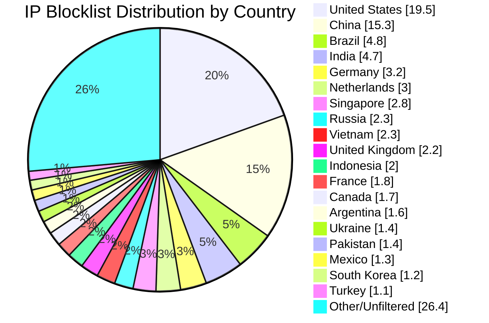

# Multi-Country IP Aggregation Statistics

**Last Updated:** 2026-11-05 07:08:05 UTC

## 📈 Country Distribution

## Overall Summary

- **Total Input IPs:** 2,040,213
- **Countries Processed:** 50
- **Combined Unique IPs:** 1,786,455
- **Combined Output File:** `aggregated-multi-50countries-combined.txt`
- **Overall Filter Rate:** 87.56%

## Per-Country Results

| Country | Code | Networks Found | Networks Optimized | IPs Matched | Filter Rate | Output File |
|---------|------|----------------|--------------------|-----------|-----------|-----------|
| United States | US | 129,071 | 127,174 | 396,838 | 19.45% | `aggregated-us-only.txt` |
| China | CN | 7,999 | 7,998 | 311,653 | 15.28% | `aggregated-cn-only.txt` |
| India | IN | 13,685 | 13,660 | 95,966 | 4.70% | `aggregated-in-only.txt` |
| Germany | DE | 30,362 | 30,247 | 66,030 | 3.24% | `aggregated-de-only.txt` |
| Russia | RU | 13,244 | 13,015 | 47,538 | 2.33% | `aggregated-ru-only.txt` |
| United Kingdom | GB | 36,392 | 36,222 | 45,459 | 2.23% | `aggregated-gb-only.txt` |
| Thailand | TH | 2,099 | 2,099 | 18,721 | 0.92% | `aggregated-th-only.txt` |
| Vietnam | VN | 2,273 | 2,273 | 46,160 | 2.26% | `aggregated-vn-only.txt` |
| South Korea | KR | 4,027 | 3,999 | 23,883 | 1.17% | `aggregated-kr-only.txt` |
| Brazil | BR | 11,631 | 11,587 | 96,921 | 4.75% | `aggregated-br-only.txt` |
| Taiwan | TW | 2,453 | 2,453 | 22,204 | 1.09% | `aggregated-tw-only.txt` |
| Canada | CA | 17,665 | 17,536 | 35,580 | 1.74% | `aggregated-ca-only.txt` |
| Singapore | SG | 9,799 | 9,775 | 56,428 | 2.77% | `aggregated-sg-only.txt` |
| Italy | IT | 9,875 | 9,842 | 23,121 | 1.13% | `aggregated-it-only.txt` |
| Netherlands | NL | 18,435 | 18,337 | 61,266 | 3.00% | `aggregated-nl-only.txt` |
| Indonesia | ID | 6,776 | 6,755 | 40,753 | 2.00% | `aggregated-id-only.txt` |
| France | FR | 33,939 | 33,914 | 37,406 | 1.83% | `aggregated-fr-only.txt` |
| Venezuela | VE | 1,001 | 1,001 | 11,585 | 0.57% | `aggregated-ve-only.txt` |
| Australia | AU | 12,281 | 12,208 | 20,543 | 1.01% | `aggregated-au-only.txt` |
| Turkey | TR | 3,587 | 3,552 | 23,322 | 1.14% | `aggregated-tr-only.txt` |
| Ukraine | UA | 5,397 | 5,356 | 28,502 | 1.40% | `aggregated-ua-only.txt` |
| Iran | IR | 2,068 | 2,067 | 8,710 | 0.43% | `aggregated-ir-only.txt` |
| Poland | PL | 8,443 | 8,412 | 20,640 | 1.01% | `aggregated-pl-only.txt` |
| Mexico | MX | 4,438 | 4,431 | 26,556 | 1.30% | `aggregated-mx-only.txt` |
| Spain | ES | 11,701 | 11,695 | 16,525 | 0.81% | `aggregated-es-only.txt` |
| Argentina | AR | 3,528 | 3,528 | 33,079 | 1.62% | `aggregated-ar-only.txt` |
| Egypt | EG | 780 | 780 | 5,739 | 0.28% | `aggregated-eg-only.txt` |
| Pakistan | PK | 1,436 | 1,434 | 28,264 | 1.39% | `aggregated-pk-only.txt` |
| Malaysia | MY | 2,631 | 2,631 | 10,121 | 0.50% | `aggregated-my-only.txt` |
| Bulgaria | BG | 2,370 | 2,356 | 4,181 | 0.20% | `aggregated-bg-only.txt` |
| Czechia | CZ | 3,775 | 3,773 | 2,962 | 0.15% | `aggregated-cz-only.txt` |
| Colombia | CO | 2,337 | 2,337 | 13,370 | 0.66% | `aggregated-co-only.txt` |
| United Arab Emirates | AE | 3,990 | 3,990 | 7,074 | 0.35% | `aggregated-ae-only.txt` |
| Romania | RO | 4,119 | 4,108 | 3,951 | 0.19% | `aggregated-ro-only.txt` |
| Kazakhstan | KZ | 1,359 | 1,358 | 5,076 | 0.25% | `aggregated-kz-only.txt` |
| Morocco | MA | 518 | 518 | 6,959 | 0.34% | `aggregated-ma-only.txt` |
| Saudi Arabia | SA | 1,766 | 1,766 | 7,945 | 0.39% | `aggregated-sa-only.txt` |
| South Africa | ZA | 4,193 | 4,180 | 14,265 | 0.70% | `aggregated-za-only.txt` |
| Bangladesh | BD | 2,864 | 2,862 | 20,438 | 1.00% | `aggregated-bd-only.txt` |
| Chile | CL | 2,002 | 2,000 | 11,364 | 0.56% | `aggregated-cl-only.txt` |
| Nigeria | NG | 1,171 | 1,171 | 3,014 | 0.15% | `aggregated-ng-only.txt` |
| Kenya | KE | 928 | 928 | 5,216 | 0.26% | `aggregated-ke-only.txt` |
| Algeria | DZ | 225 | 225 | 3,029 | 0.15% | `aggregated-dz-only.txt` |
| Serbia | RS | 1,020 | 1,020 | 2,083 | 0.10% | `aggregated-rs-only.txt` |
| Peru | PE | 1,132 | 1,131 | 3,787 | 0.19% | `aggregated-pe-only.txt` |
| Sri Lanka | LK | 262 | 262 | 1,198 | 0.06% | `aggregated-lk-only.txt` |
| Iraq | IQ | 700 | 700 | 6,332 | 0.31% | `aggregated-iq-only.txt` |
| Ethiopia | ET | 116 | 116 | 2,032 | 0.10% | `aggregated-et-only.txt` |
| Ghana | GH | 365 | 365 | 853 | 0.04% | `aggregated-gh-only.txt` |
| Belarus | BY | 439 | 439 | 1,813 | 0.09% | `aggregated-by-only.txt` |

## IP Sources

- **Source 1:** https://raw.githubusercontent.com/borestad/firehol-mirror/refs/heads/main/firehol_level1.netset
- **Source 2:** https://raw.githubusercontent.com/borestad/firehol-mirror/refs/heads/main/firehol_level2.netset
- **Source 3:** https://rules.emergingthreats.net/fwrules/emerging-Block-IPs.txt
- **Source 4:** https://feodotracker.abuse.ch/downloads/ipblocklist_recommended.txt
- **Source 5:** https://raw.githubusercontent.com/stamparm/ipsum/master/levels/2.txt
- **Source 6:** https://raw.githubusercontent.com/borestad/iplists/refs/heads/main/spamhaus/spamhaus-drop.ipv4
- **Source 7:** https://raw.githubusercontent.com/borestad/iplists/refs/heads/main/spamhaus/spamhaus-asndrop.ipv4
- **Source 8:** https://raw.githubusercontent.com/romainmarcoux/malicious-ip/refs/heads/main/full-300k-aa.txt
- **Source 9:** https://raw.githubusercontent.com/romainmarcoux/malicious-ip/refs/heads/main/full-300k-ab.txt
- **Source 10:** https://raw.githubusercontent.com/romainmarcoux/malicious-ip/refs/heads/main/full-300k-ac.txt
- **Source 11:** https://raw.githubusercontent.com/romainmarcoux/malicious-ip/refs/heads/main/full-300k-ad.txt
- **Source 12:** http://cinsscore.com/list/ci-badguys.txt
- **Source 13:** https://cdn.jsdelivr.net/gh/LittleJake/ip-blacklist/all_blacklist.txt
- **Source 14:** https://raw.githubusercontent.com/MagicTeaMC/bad-ips/refs/heads/main/bad-ips.txt
- **Source 15:** https://raw.githubusercontent.com/MagicTeaMC/MCSTORM-IP/main/mcstorm-ip.txt
- **Source 16:** https://opendbl.net/lists/blocklistde-all.list
- **Source 17:** https://raw.githubusercontent.com/bitwire-it/ipblocklist/refs/heads/main/ip-list.txt
- **Source 18:** https://raw.githubusercontent.com/sefinek/Malicious-IP-Addresses/refs/heads/main/lists/main.txt
- **Source 19:** https://raw.githubusercontent.com/borestad/firehol-mirror/refs/heads/main/firehol_level3.netset
- **Source 20:** https://raw.githubusercontent.com/borestad/firehol-mirror/refs/heads/main/firehol_level4.netset
- **Source 21:** https://raw.githubusercontent.com/borestad/firehol-mirror/refs/heads/main/firehol_webserver.netset

## Configuration Details

